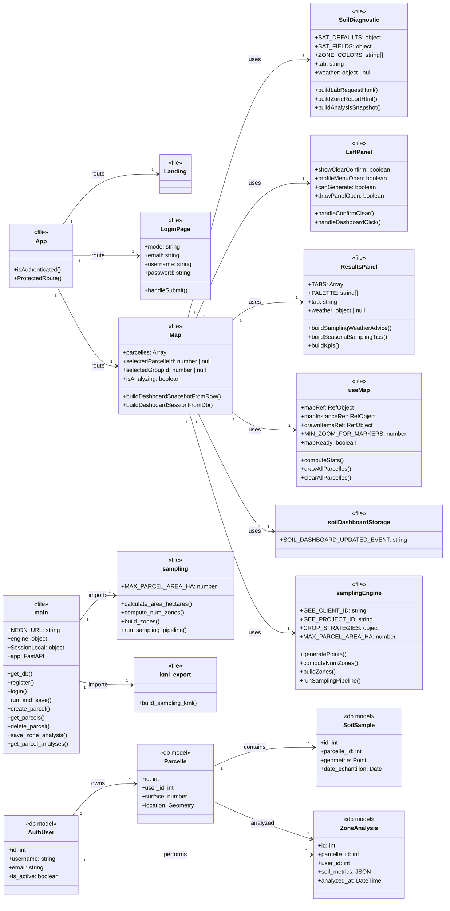

# Project Class Diagram

This diagram uses the real source file names as class names, and only functions that actually exist in the codebase.

## What Each Function Does

### App
- `isAuthenticated()` checks whether a token exists in `localStorage`.
- `ProtectedRoute()` blocks protected pages unless the user is authenticated.

### LoginPage
- `handleSubmit()` sends the login or register request and stores the token on success.

### Landing
- `Landing()` is the landing-page component; it sets the page body class and navigates to login when the user enters.

### Map
- `buildDashboardSnapshotFromRow()` turns one analysis row into a dashboard snapshot object.
- `buildDashboardSessionFromDb()` rebuilds the full dashboard session from saved database rows.

### SoilDiagnostic
- `buildLabRequestHtml()` creates the HTML used for the lab request print/export view.
- `buildZoneReportHtml()` creates the HTML report for a zone analysis.
- `buildAnalysisSnapshot()` packages the analysis state into a snapshot for storage or export.

### LeftPanel
- `handleConfirmClear()` confirms the clear-all action and then clears the parcels.
- `handleDashboardClick()` opens the dashboard only when it is available.

### ResultsPanel
- `buildSamplingWeatherAdvice()` creates sampling advice from weather conditions.
- `buildSeasonalSamplingTips()` creates crop-season sampling tips.
- `buildKpis()` creates the KPI cards shown in the results panel.

### useMap
- `computeStats()` computes parcel area, perimeter, and bounds.
- `drawAllParcelles()` redraws every parcel polygon and its label.
- `clearAllParcelles()` removes every parcel layer from the map.

### soilDashboardStorage
- `getDashboardHistory()` returns the latest and previous analysis entries.
- `saveDashboardState()` stores the latest dashboard state and keeps only the last two entries.
- `isParcelleAnalysisComplete()` checks whether the required zone results are complete.
- `clearDashboardHistory()` removes all saved dashboard data for one parcel.

### samplingEngine
- `generatePoints()` generates sampling points inside a polygon.
- `computeNumZones()` decides how many zones to create based on area and sampling mode.
- `buildZones()` splits a parcel into zones and generates points for each zone.
- `runSamplingPipeline()` is the frozen frontend stub that returns mock sampling results.

### main
- `get_db()` opens a database session and closes it after use.
- `register()` creates a new auth user and farmer record.
- `login()` verifies credentials and returns a JWT token.
- `run_and_save()` runs the sampling pipeline and stores soil samples in the database.
- `create_parcel()` creates or reuses a parcel record.
- `get_parcels()` returns all parcels owned by the current user.
- `delete_parcel()` deletes one parcel and its related data.
- `save_zone_analysis()` stores one analyzed zone result.
- `get_parcel_analyses()` returns the latest two analyses per zone for a parcel.

### sampling
- `calculate_area_hectares()` computes polygon area in hectares.
- `compute_num_zones()` decides the number of zones for a parcel.
- `build_zones()` splits the parcel into sampling zones.
- `run_sampling_pipeline()` runs the full backend sampling process.

### kml_export
- `build_sampling_kml()` builds the full KML document for all zones and points.