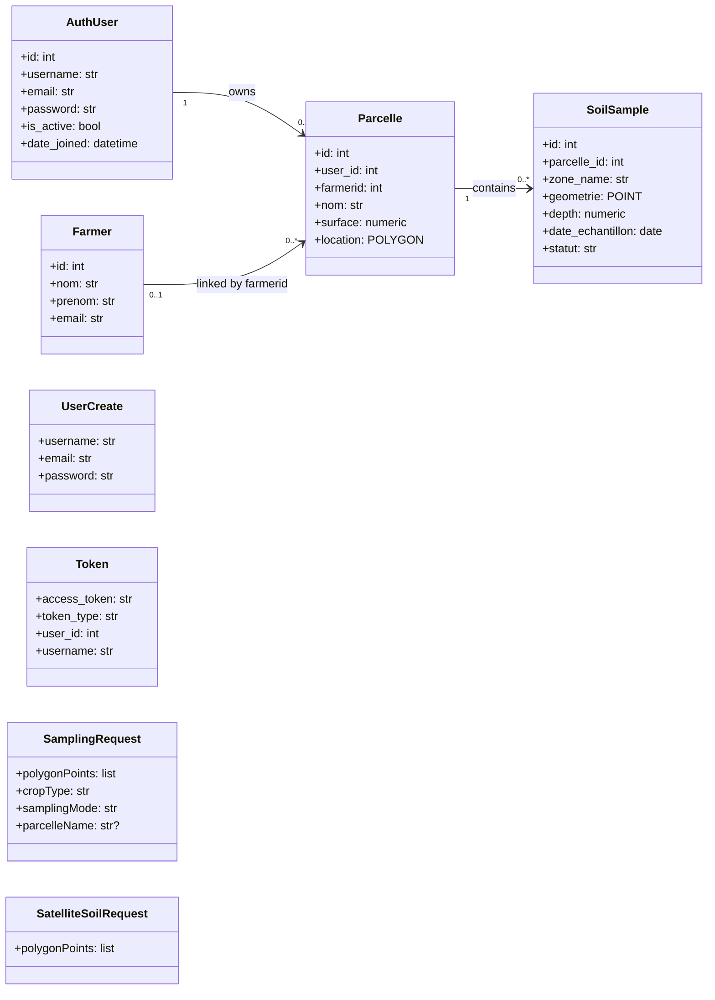
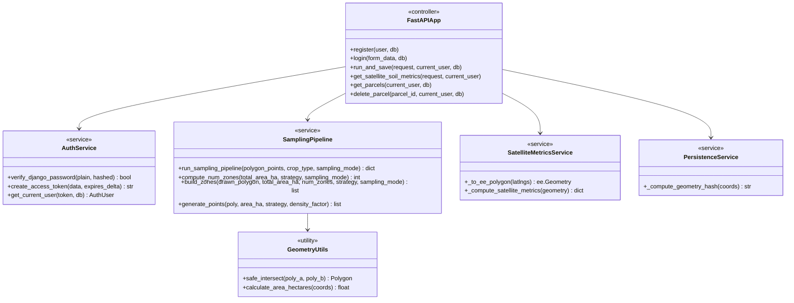
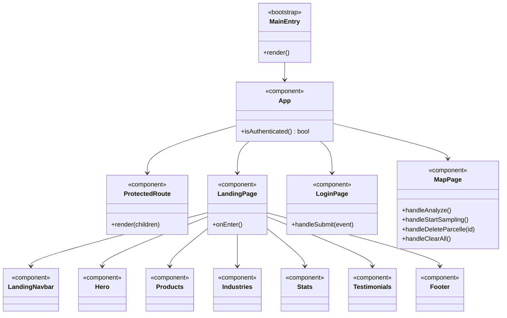
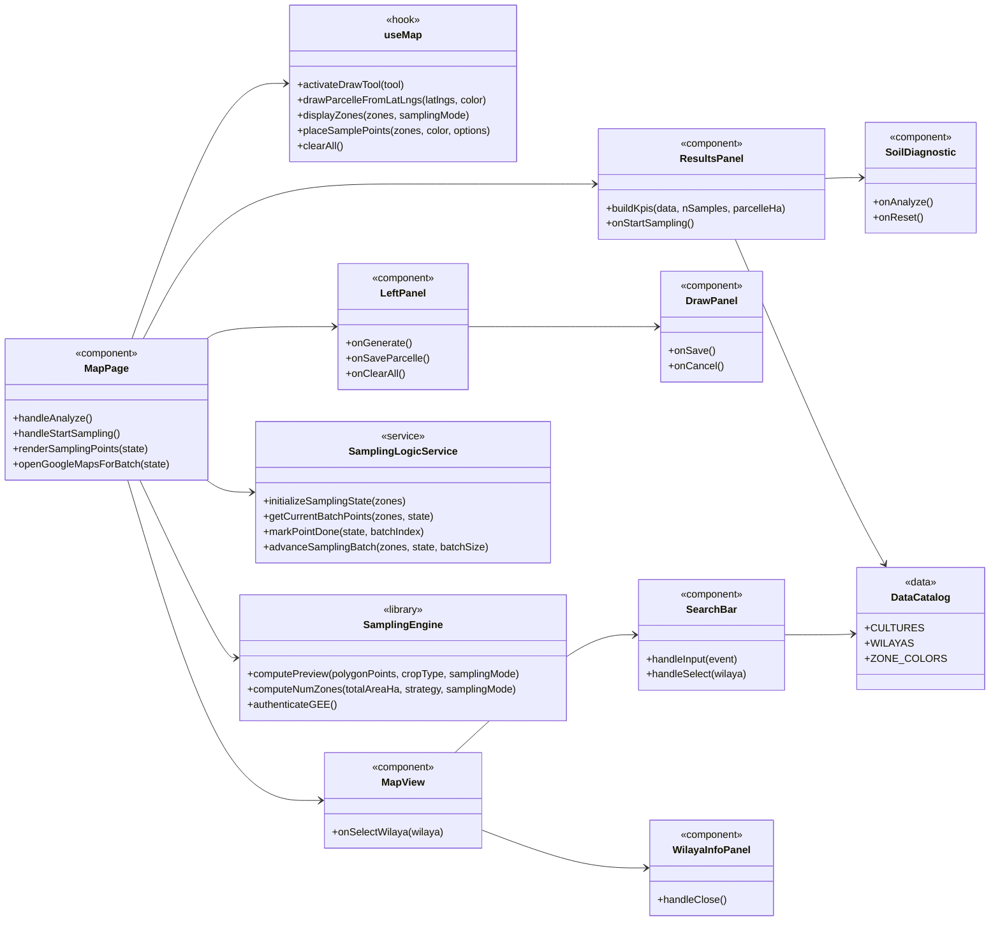
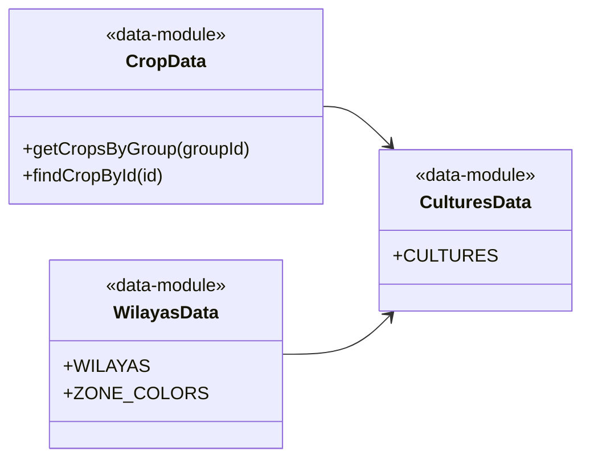

# Project Class Diagrams

This document provides complete UML-style class diagrams for the project.
Only essential functions are shown.

## 1) Backend Domain Model (SQLAlchemy + Pydantic)

## 2) Backend Service and API Layer

## 3) Frontend App and Routing Structure

## 4) Frontend Map Module (Core Flow)

## 5) Optional Data Utility Modules

