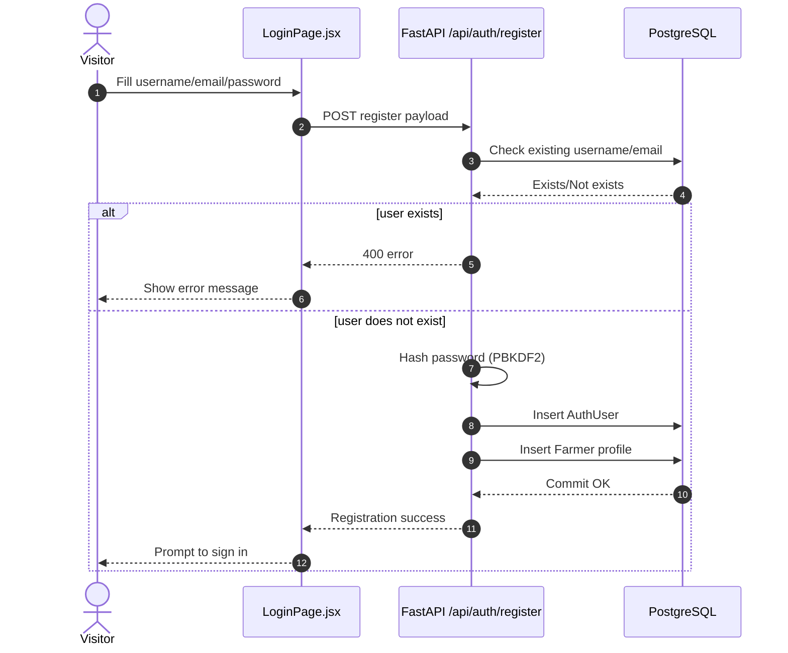
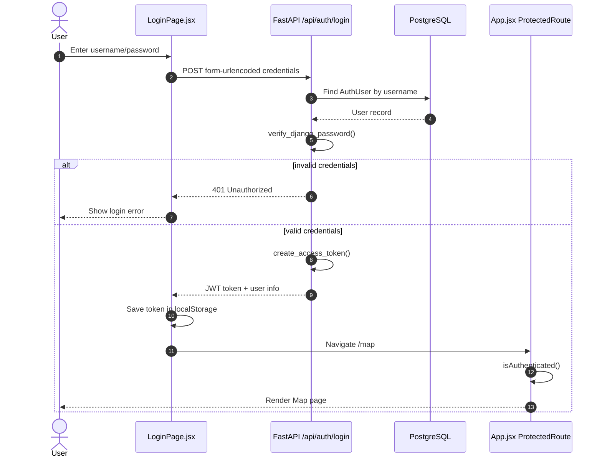
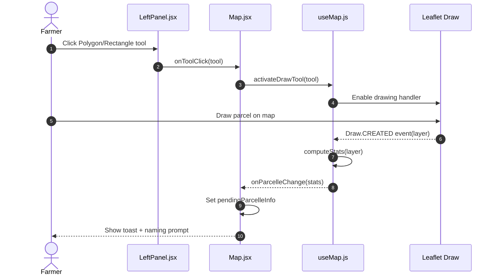
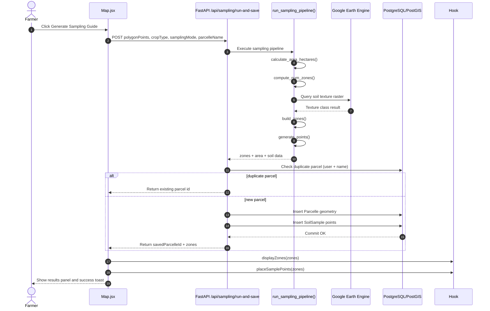
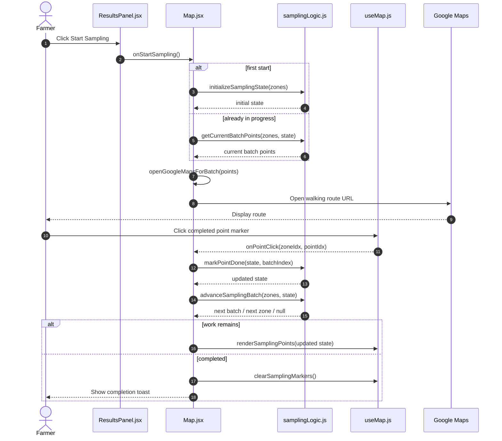
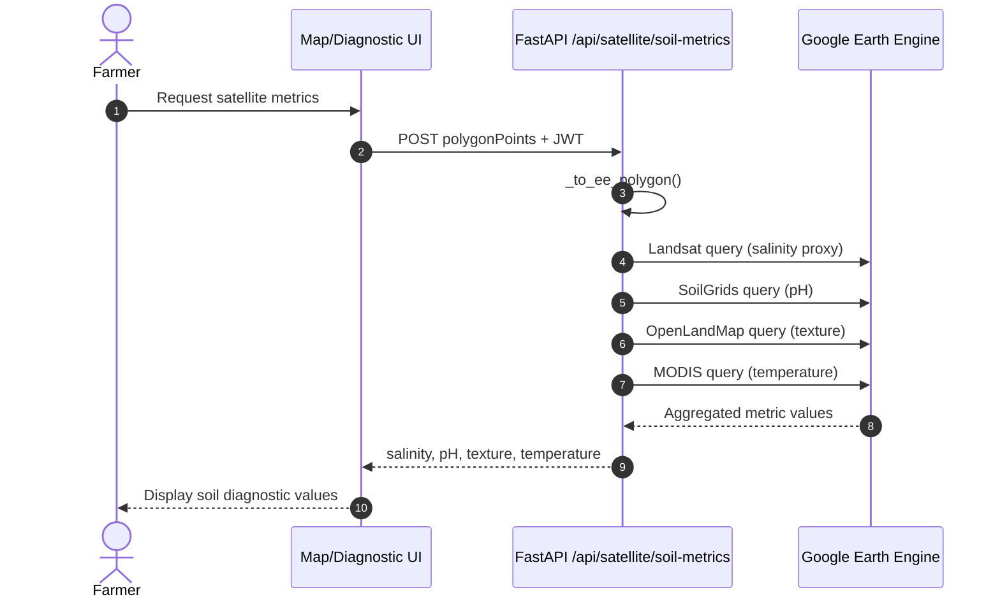
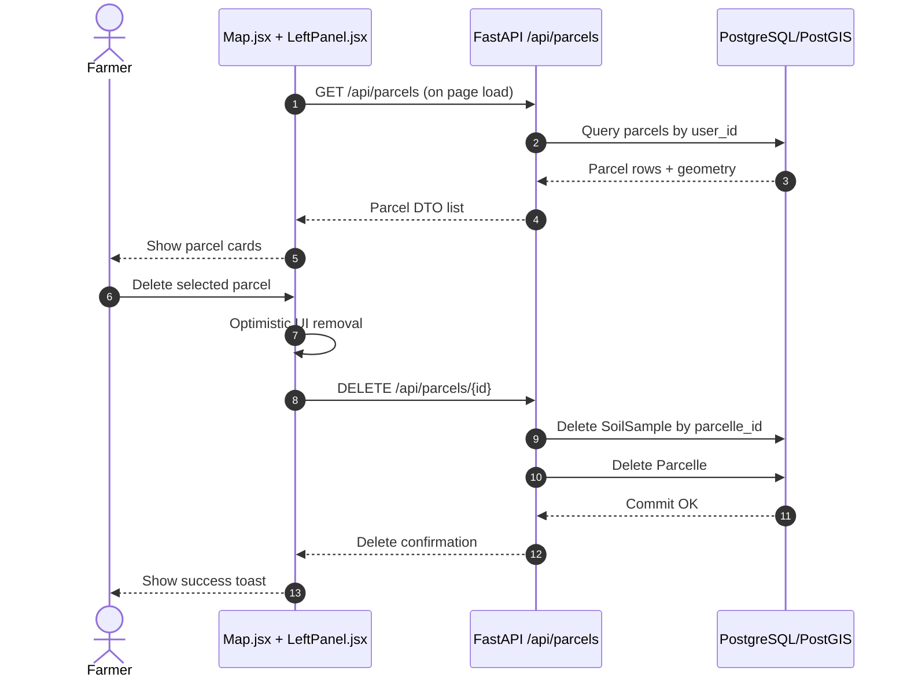
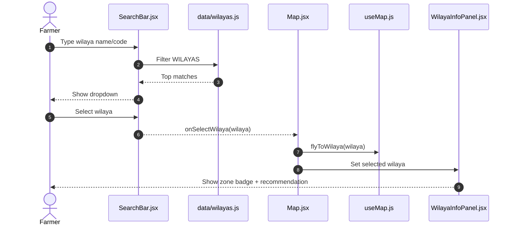

# Project Sequence Diagrams

This document provides the key sequence diagrams for the project.
Only essential interactions are included.

## 1) User Registration Sequence

## 2) User Login and Protected Route Sequence

## 3) Draw Parcel and Save in UI Sequence

## 4) Run Sampling Analysis and Save to DB Sequence

## 5) Guided Sampling Batch Navigation Sequence

## 6) Satellite Soil Metrics Sequence

## 7) Parcel Listing and Deletion Sequence

## 8) Wilaya Search and Info Panel Sequence

