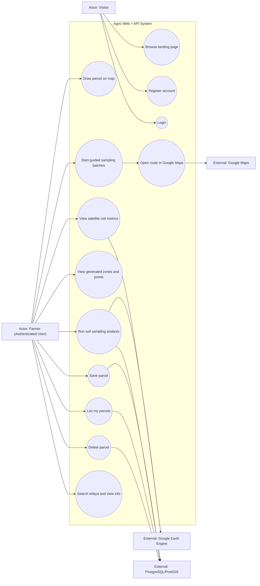
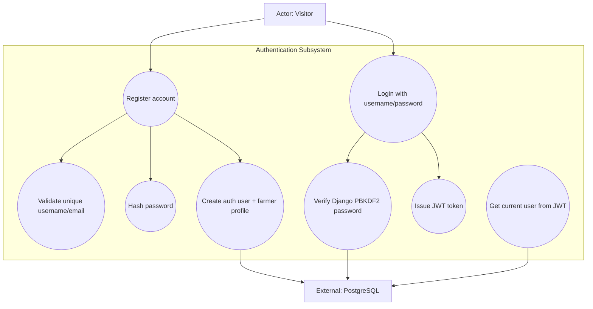
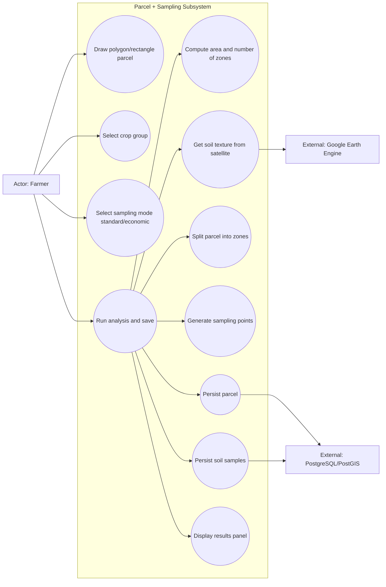
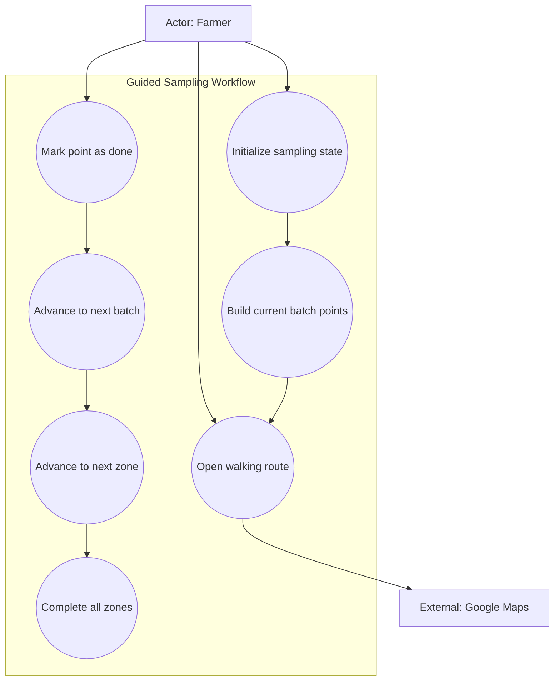
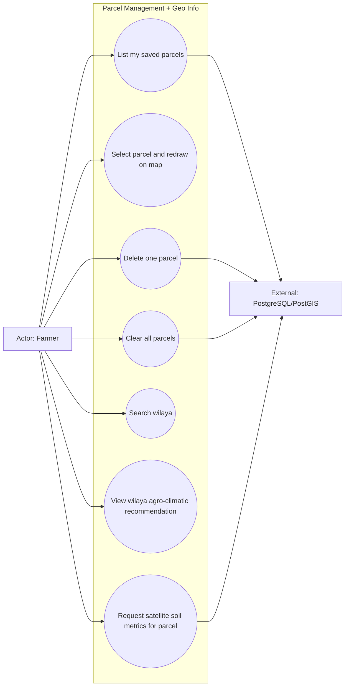

# Project Use Case Diagrams

This document provides the use case diagrams for the project.
Only essential use cases are included.

## 1) Global System Use Case Diagram

## 2) Authentication Use Cases

## 3) Parcel and Sampling Use Cases

## 4) Guided Field Sampling Use Cases

## 5) Parcel Management and Geographic Info Use Cases

## 6) Actor Summary

- Visitor
- Farmer (authenticated user)
- Google Earth Engine (external geospatial service)
- PostgreSQL/PostGIS (persistent storage)
- Google Maps (external routing/navigation)
